# Bộ Tranh Gợi Nhớ — 28 Tranh Theo Cụm Chương (Level 4)

> **Mục đích sử dụng:** Bộ 28 tranh minh họa thuần hình ảnh (không chữ gợi ý) đóng vai trò điểm tựa thị giác cuối cùng cho người kể sau khi đã nắm vững 180 Chương ở Level 1–3.

---

# Quyển I: Khởi Nguyên Và Ánh Sáng Đầu Tiên (67 Chương)

## Tranh 01 (Chương 1–2): Khởi Nguyên Thế Giới Và Cuộc Chiến Giữa Ánh Sáng Với Bóng Tối

## Tranh 02 (Chương 3–6, 10–11, 13–14): Bảy Ngày Sáng Thế Và Sự Tạo Dựng Con Người Đầu Tiên
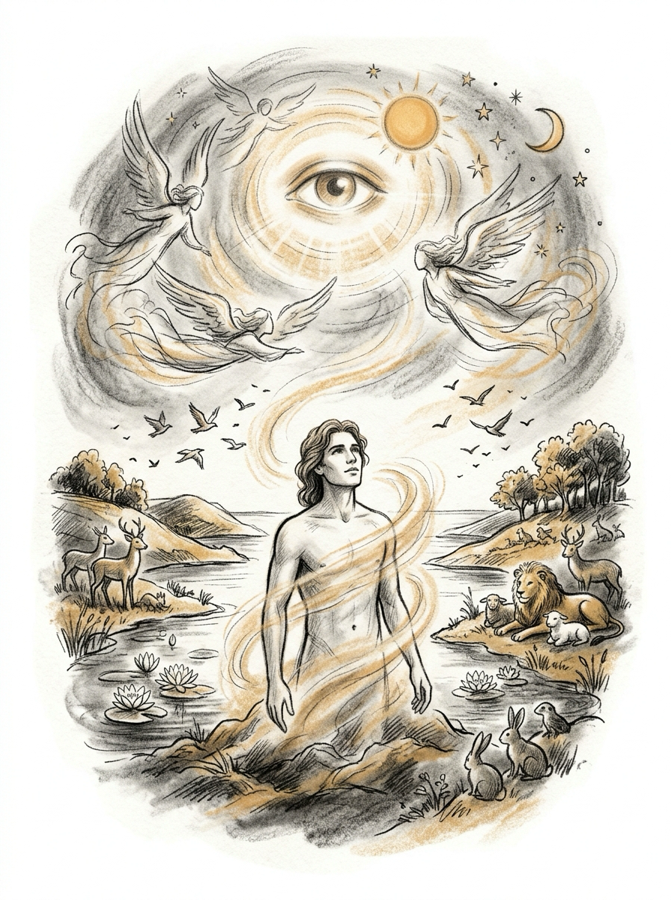

## Tranh 03 (Chương 7–9, 12): Muôn Hoa, Cây Cỏ Và Loài Vật Giữa Ánh Sáng Và Bóng Tối
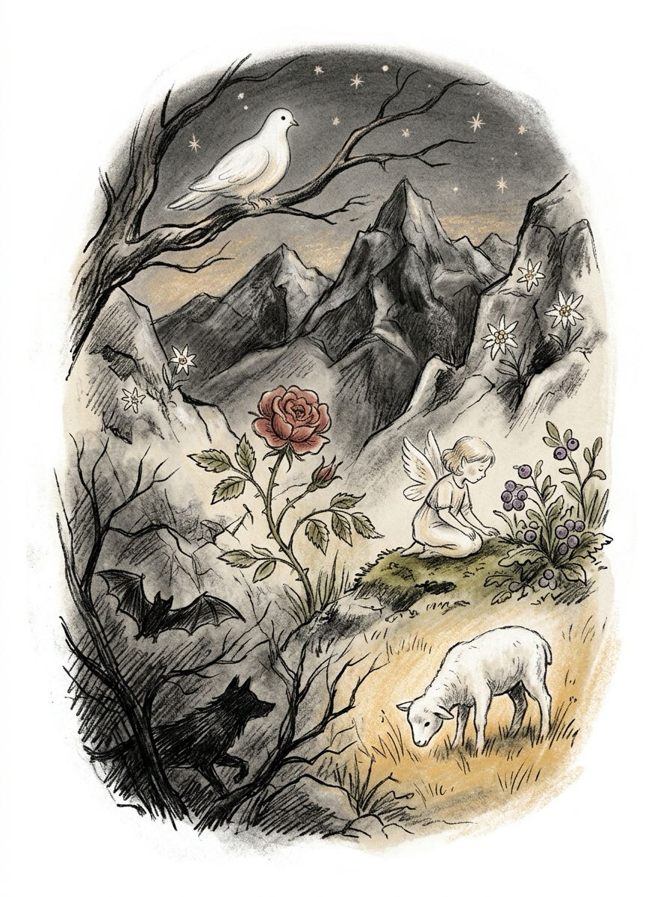

## Tranh 04 (Chương 15–17): Vườn Địa Đàng, Trái Cấm Và Những Giọt Nước Mắt Đầu Tiên Trên Mặt Đất

## Tranh 05 (Chương 18–26): Cain, Abel, Người Em Mới Seth Và Ba Hạt Giống Cây Sự Sống
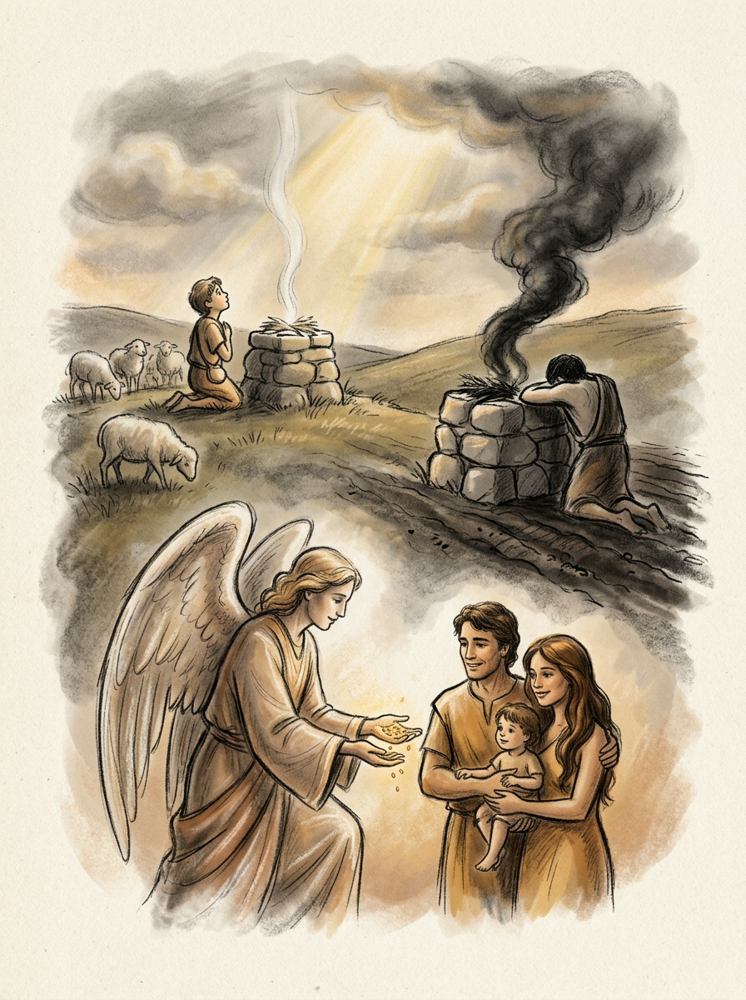

## Tranh 06 (Chương 27–37): Ba Con Trai Của Cain: Thuần Hóa Muôn Thú, Tiếng Đàn Thiên Giới, Lò Rèn Sắt Và Bi Kịch Kenos
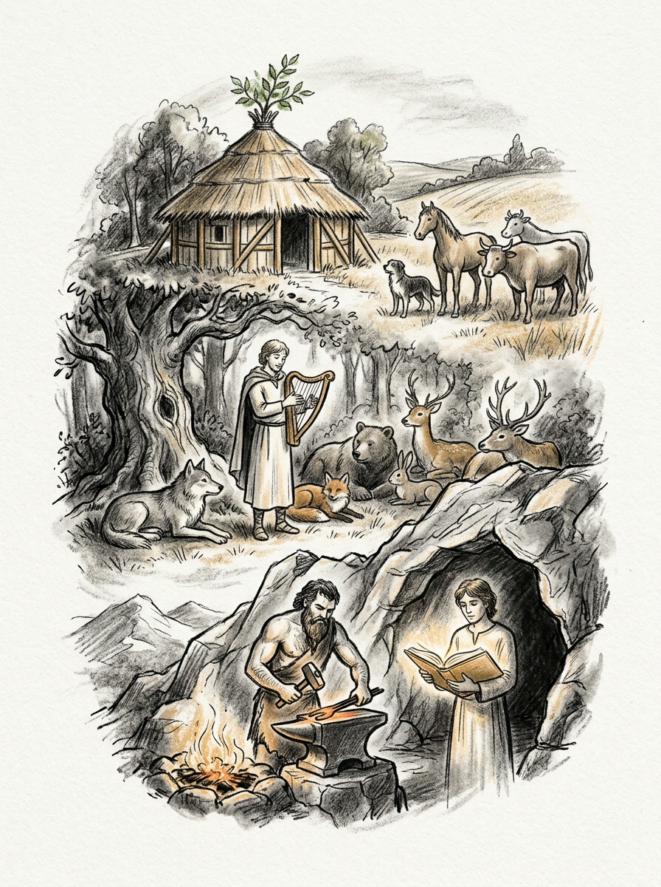

## Tranh 07 (Chương 38–45): Ánh Sáng Của Enoch Giữa Đêm Tối Ngẫu Tượng
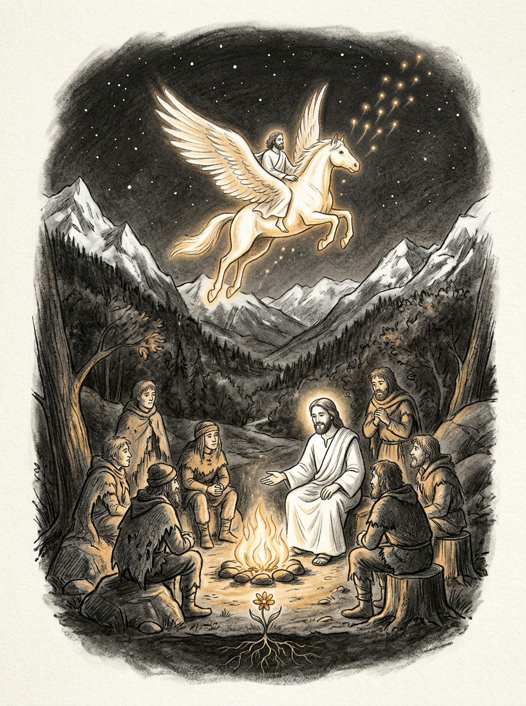

## Tranh 08 (Chương 46–67): Con Tàu Của Noah, Cơn Đại Hồng Thủy Và Chiếc Cầu Vồng Giao Ước

---

# Quyển II: Hành Trình Về Đất Hứa (56 Chương)

## Tranh 09 (Chương 1–5): Ngai Bảy Tầng Của Nimrod, Tháp Babel Và Chàng Trai Abram Bước Ra Khỏi Lò Lửa
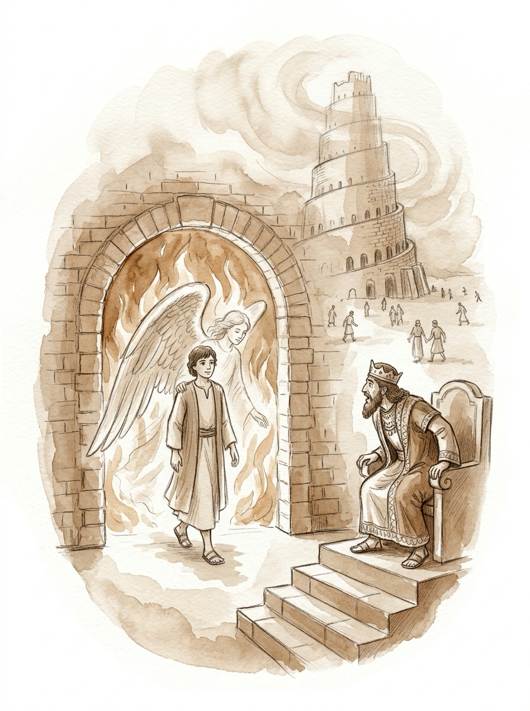

## Tranh 10 (Chương 6–12): Lời Hứa Dưới Trời Sao, Cây Cổ Thụ Của Abraham, Phép Thử Trên Núi Moriah Và Cô Dâu Rebecca

## Tranh 11 (Chương 13–17): Hai Anh Em Esau – Jacob, Chiếc Thang Ánh Sáng Và Cuộc Hòa Giải
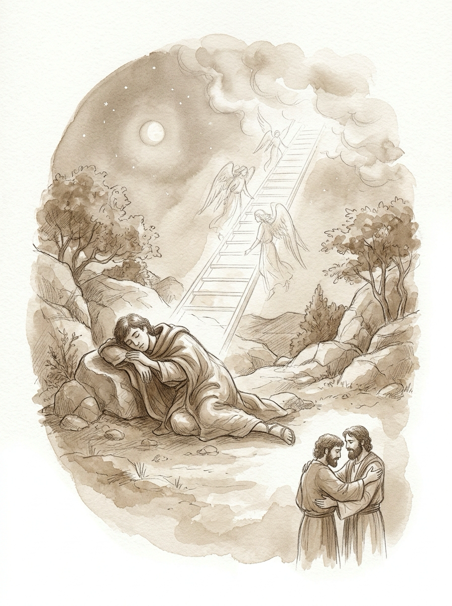

## Tranh 12 (Chương 18–24): Chiếc Áo Ngũ Sắc Của Joseph, Giấc Mơ Pharaoh Và Cuộc Đoàn Tụ Nước Mắt
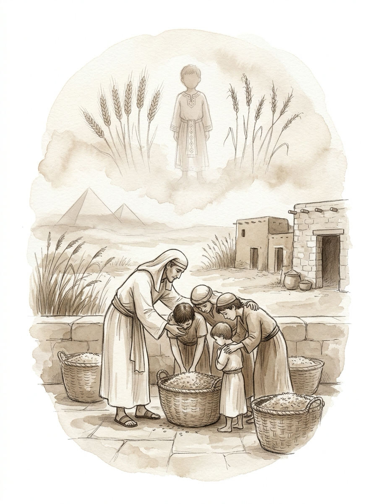

## Tranh 13 (Chương 25–30): Hài Nhi Moses Trên Sông Nile, Bụi Gai Bốc Cháy Và Biển Đỏ Rẽ Đôi
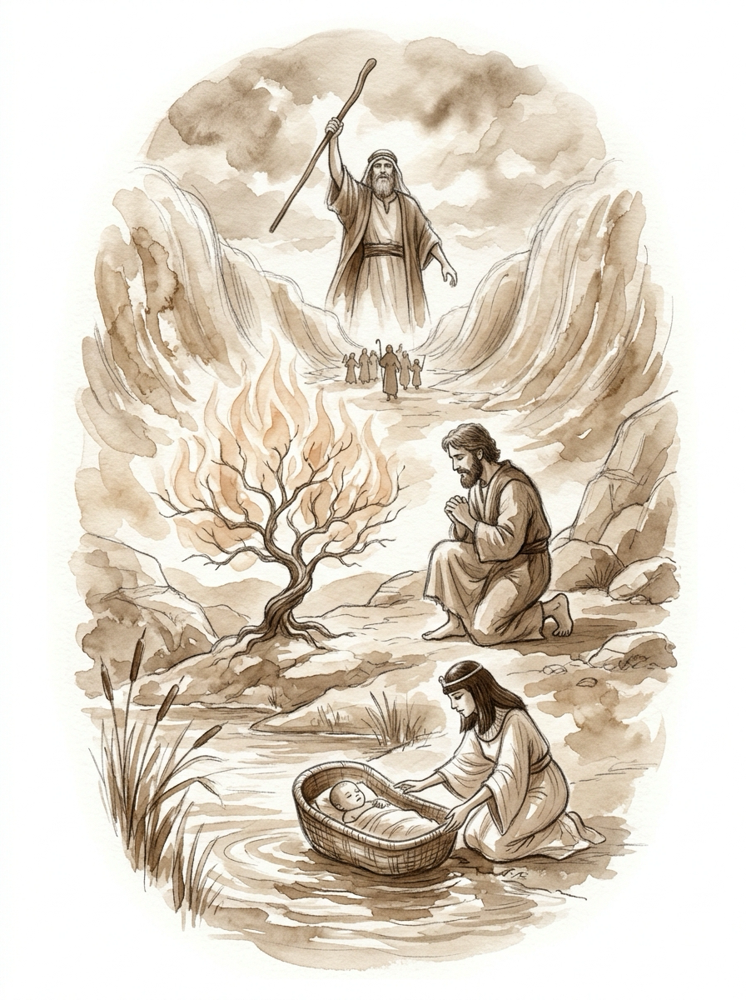

## Tranh 14 (Chương 31–44): Mười Điều Răn Trên Đỉnh Sinai, Ngôi Đền Tạm, Cái Nhìn Từ Núi Nebo Và Joshua Vượt Sông Jordan

## Tranh 15 (Chương 45–56): Vua Saul, Tiếng Đàn Chăn Cừu Của David Và Giấc Mơ Cây Thế Giới
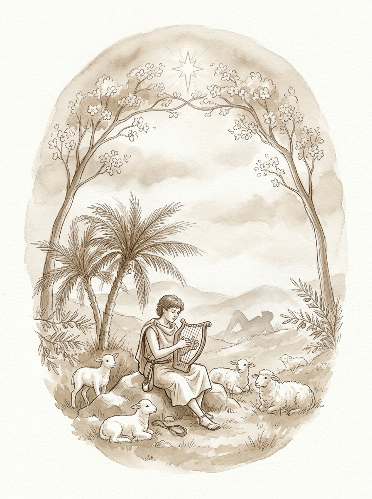

---

# Quyển III: Chúng Ta Sẽ Xây Một Đền Thờ (32 Chương)

## Tranh 16 (Chương 1–6): Trái Tim Thông Tuệ Của Vua Solomon Và Ngôi Đền Thờ Jerusalem
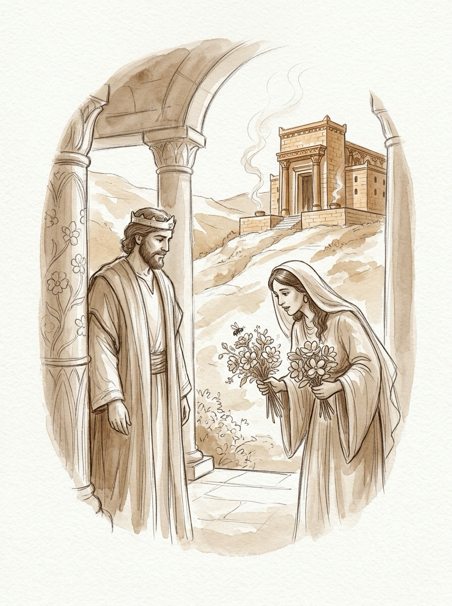

## Tranh 17 (Chương 7–9): Tiên Tri Elijah: Hũ Bột Không Vơi, Ngọn Lửa Trên Núi Carmel Và Cỗ Xe Lửa

## Tranh 18 (Chương 10–11): Chuyến Đi Của Chàng Trẻ Tobias Và Thiên Thần Chữa Lành Raphael
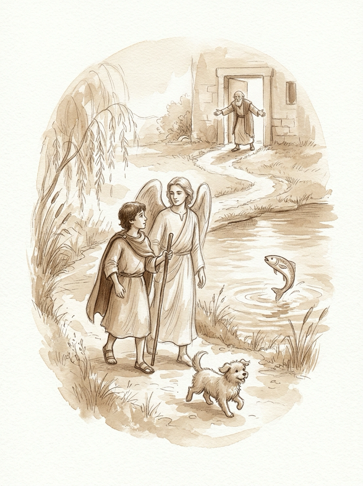

## Tranh 19 (Chương 12–17): Đôi Môi Chạm Lửa Của Isaiah Và Jeremiah Giấu Hòm Giao Ước Trước Giờ Đền Thờ Sụp Đổ

## Tranh 20 (Chương 18–24): Daniel Và Các Bạn Trẻ Nơi Xứ Lưu Đày: Lò Lửa Và Hang Sư Tử Babylon
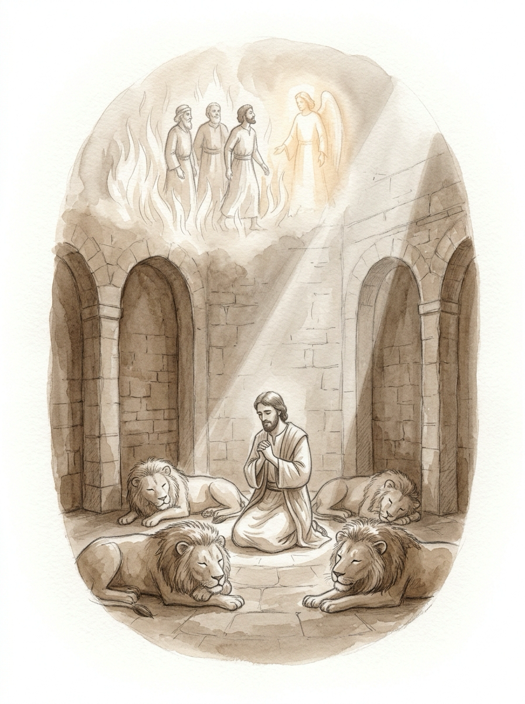

## Tranh 21 (Chương 27): Tiên Tri Jonah Trong Bụng Cá Khổng Lồ Và Bài Học Về Lòng Thương Xót
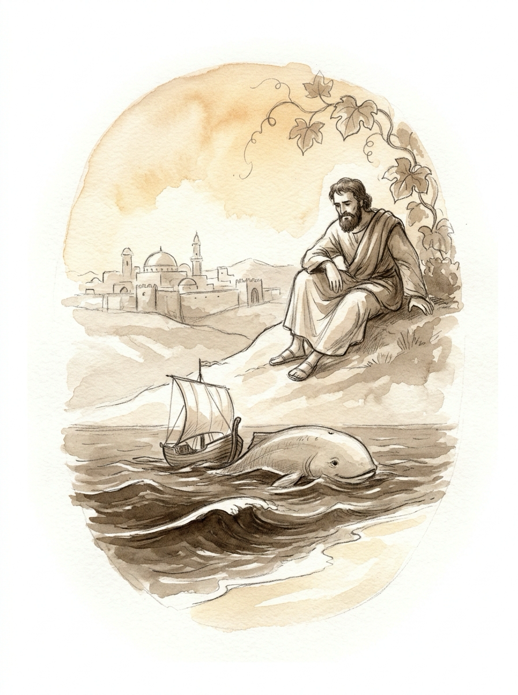

## Tranh 22 (Chương 25–26, 28–32): Xây Lại Tường Thành, Lòng Kiên Trung Của Job Và Ngọn Lửa Phục Hưng Đền Thờ

---

# Quyển IV: Hai Đứa Trẻ Giáng Sinh Và Bình Minh Bên Sông Jordan (15 Chương)

## Tranh 23 (Chương 1, 9–10): Hai Ngọn Sáng Đêm Đông, Lời Báo Tin Trong Đền Thờ Và Cuộc Hội Ngộ Của Hai Người Mẹ

## Tranh 24 (Chương 2): Đứa Trẻ Dòng Dõi Vua, Ba Nhà Thông Thái Phương Đông Và Cuộc Chạy Trốn Trong Đêm

## Tranh 25 (Chương 3–4): Đứa Trẻ Dòng Dõi Mục Đồng, Tiếng Hát Trên Đồng Cỏ Và Hai Gia Đình Ở Nazareth

## Tranh 26 (Chương 5–8): Năm Thứ Mười Hai Trong Đền Thờ, Nỗi Đau Mùa Đông Và Người Thợ Mộc Khôn Ngoan

## Tranh 27 (Chương 11–15): John Giữa Cộng Đồng Áo Trắng, Tiếng Gọi Hoang Địa Và Bình Minh Trên Sông Jordan

---

# Quyển V (Ngoại Truyện): Hạt Giống Yêu Thương Đêm Đông (10 Chương)

## Tranh 28 (Chương 1–10): Ngoại Truyện: Từ Chiếc Áo Choàng Đỏ Của Thánh Nicholas Đến Ông Già Noel Đêm Giáng Sinh

