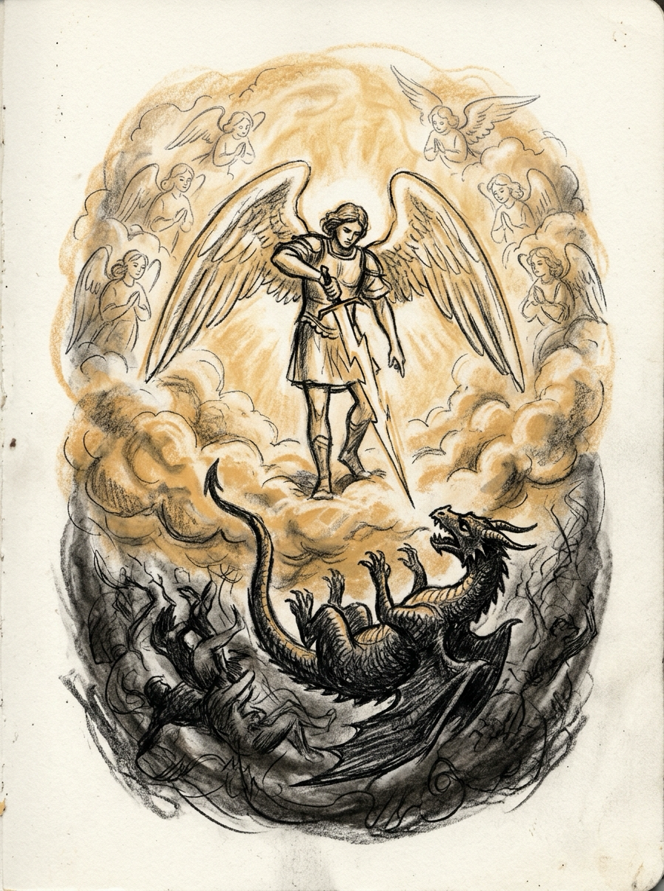
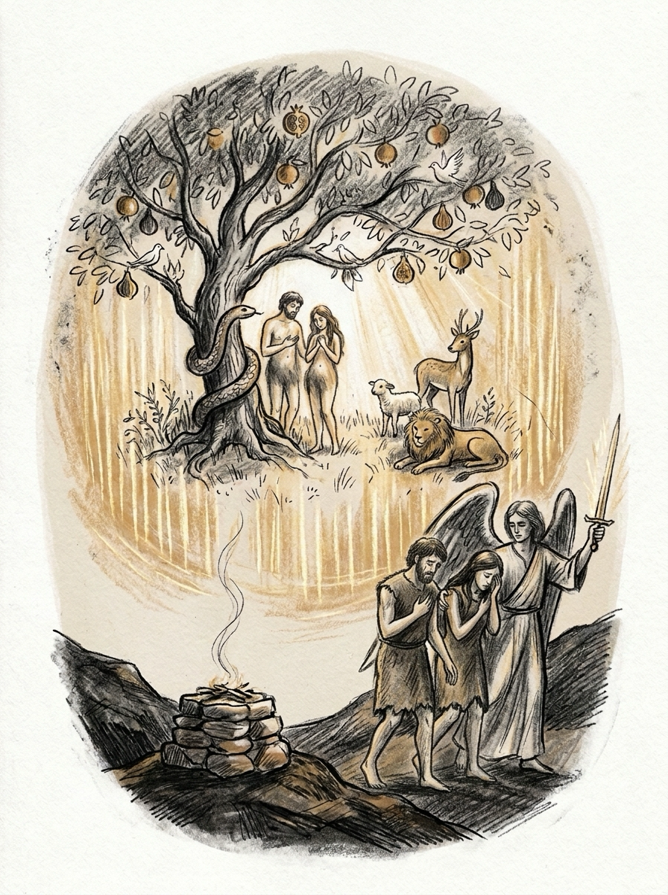
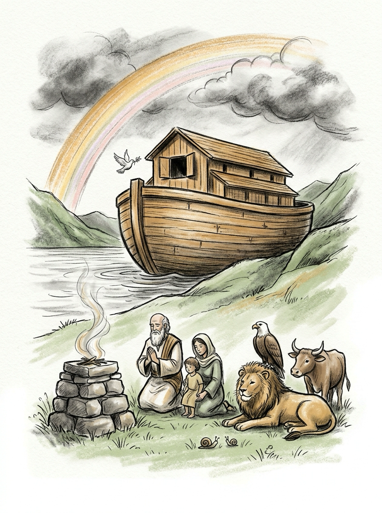
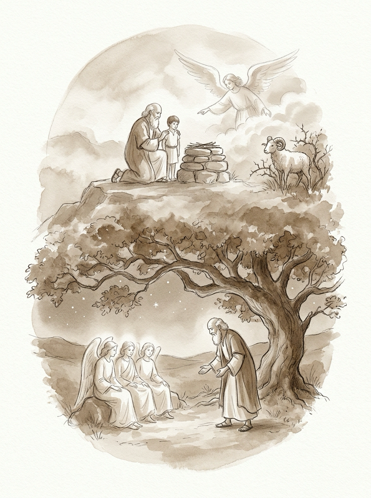
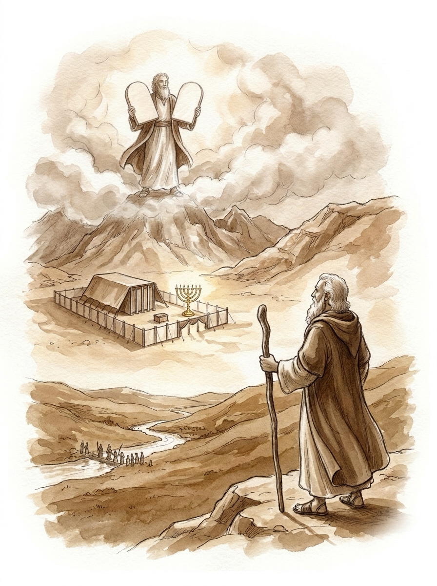
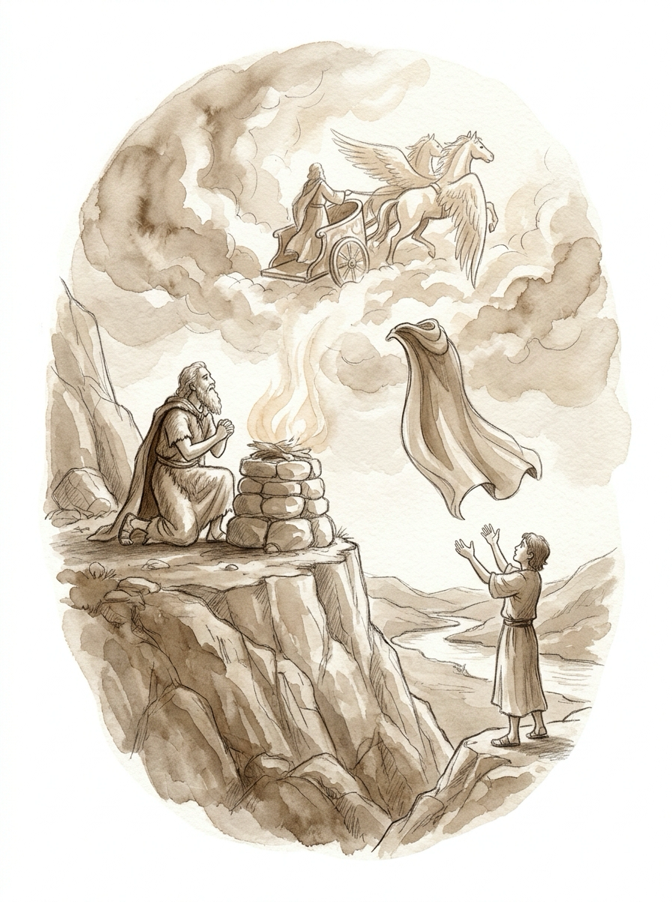
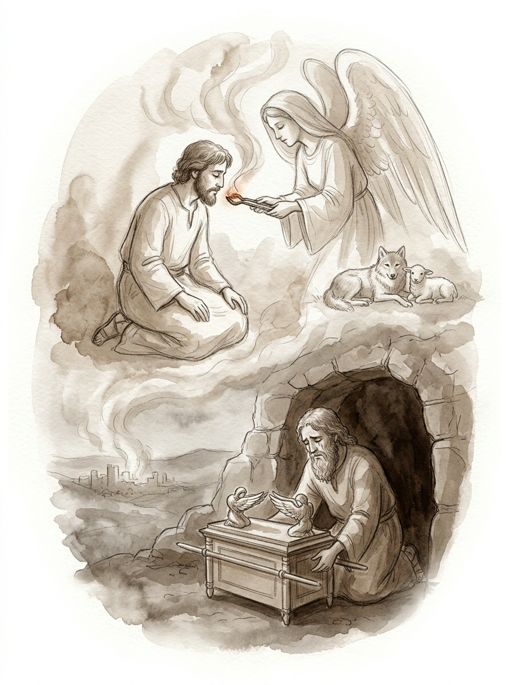

# Bộ Tranh Gợi Nhớ — 28 Phân Cảnh (Level 4)

# Quyển I: Khởi Nguyên Và Ánh Sáng Đầu Tiên

## Phân cảnh 01 (`canh-01-khoi-nguyen-va-cuoc-chien-anh-sang`): Khởi Nguyên Thế Giới Và Cuộc Chiến Giữa Ánh Sáng Với Bóng Tối

## Phân cảnh 02 (`canh-02-bay-ngay-sang-the`): Bảy Ngày Sáng Thế Và Sự Tạo Dựng Con Người Đầu Tiên

## Phân cảnh 03 (`canh-03-muon-hoa-va-muon-thu-buoi-dau`): Muôn Hoa, Cây Cỏ Và Loài Vật Giữa Ánh Sáng Và Bóng Tối

## Phân cảnh 04 (`canh-04-vuon-dia-dang-va-buoc-chan-xuong-tran`): Vườn Địa Đàng, Trái Cấm Và Những Giọt Nước Mắt Đầu Tiên Trên Mặt Đất

## Phân cảnh 05 (`canh-05-cain-abel-va-hat-giong-su-song`): Cain, Abel, Người Em Mới Seth Và Ba Hạt Giống Cây Sự Sống

## Phân cảnh 06 (`canh-06-con-chau-cain-va-ngon-lua-van-minh`): Ba Con Trai Của Cain: Thuần Hóa Muôn Thú, Tiếng Đàn Thiên Giới Và Lò Rèn Sắt

## Phân cảnh 07 (`canh-07-enoch-nguoi-giu-anh-sang`): Ánh Sáng Của Enoch Giữa Đêm Tối Ngẫu Tượng

## Phân cảnh 08 (`canh-08-con-tau-noah-va-cau-vong-giao-uoc`): Con Tàu Của Noah, Cơn Đại Hồng Thủy Và Chiếc Cầu Vồng Giao Ước

# Quyển II: Hành Trình Về Đất Hứa

## Phân cảnh 09 (`canh-09-thap-babel-va-abram-buoc-ra-khoi-lua`): Ngai Bảy Tầng Của Nimrod, Tháp Babel Và Chàng Trai Abram Bước Ra Khỏi Lò Lửa

## Phân cảnh 10 (`canh-10-abraham-goc-cay-thieng-va-le-hien-te-isaac`): Lời Hứa Dưới Trời Sao, Cây Cổ Thụ Của Abraham Và Phép Thử Trên Núi Moriah

## Phân cảnh 11 (`canh-11-chiec-thang-anh-sang-cua-jacob`): Hai Anh Em Esau – Jacob, Chiếc Thang Ánh Sáng Và Cuộc Hòa Giải

## Phân cảnh 12 (`canh-12-joseph-chiec-ao-ngu-sac-va-nguoi-ban-banh-mi`): Chiếc Áo Ngũ Sắc Của Joseph, Giấc Mơ Pharaoh Và Cuộc Đoàn Tụ Nước Mắt

## Phân cảnh 13 (`canh-13-moses-bui-gai-chay-va-bien-do-re-nuoc`): Hài Nhi Moses Trên Sông Nile, Bụi Gai Bốc Cháy Và Biển Đỏ Rẽ Đôi

## Phân cảnh 14 (`canh-14-muoi-dieu-ran-den-tam-va-cai-nhin-tu-nui-nebo`): Mười Điều Răn Trên Đỉnh Sinai, Ngôi Đền Tạm Và Cái Nhìn Cuối Cùng Từ Núi Nebo

## Phân cảnh 15 (`canh-15-vua-saul-tieng-dan-david-va-giac-mo-cay-the-gioi`): Vua Saul, Tiếng Đàn Chăn Cừu Của David Và Giấc Mơ Cây Thế Giới

# Quyển III: Chúng Ta Sẽ Xây Một Đền Thờ

## Phân cảnh 16 (`canh-16-solomon-trai-tim-thong-tue-va-ngoi-den-tho`): Trái Tim Thông Tuệ Của Vua Solomon Và Ngôi Đền Thờ Jerusalem

## Phân cảnh 17 (`canh-17-tien-tri-elijah-ngon-lua-trung-thuc-va-co-xe-lua`): Tiên Tri Elijah: Hũ Bột Không Vơi, Ngọn Lửa Trên Núi Carmel Và Cỗ Xe Lửa

## Phân cảnh 18 (`canh-18-hanh-trinh-cua-tobias-va-thien-than-chua-lanh`): Chuyến Đi Của Chàng Trẻ Tobias Và Thiên Thần Chữa Lành Raphael

## Phân cảnh 19 (`canh-19-isaiah-va-jeremiah-loi-tien-tri-giua-tro-tan`): Đôi Môi Chạm Lửa Của Isaiah Và Jeremiah Giấu Hòm Giao Ước Trước Giờ Đền Thờ Sụp Đổ

## Phân cảnh 20 (`canh-20-daniel-lo-lua-va-hang-su-tu-babylon`): Daniel Và Các Bạn Trẻ Nơi Xứ Lưu Đày: Lò Lửa Và Hang Sư Tử Babylon

## Phân cảnh 21 (`canh-21-jonah-con-ca-khong-lo-va-long-bao-dung`): Tiên Tri Jonah Trong Bụng Cá Khổng Lồ Và Bài Học Về Lòng Thương Xót

## Phân cảnh 22 (`canh-22-xay-lai-thanh-quach-job-va-ngon-lua-maccabeus`): Xây Lại Tường Thành, Lòng Kiên Trung Của Job Và Ngọn Lửa Phục Hưng Đền Thờ

# Quyển IV: Hai Đứa Trẻ Giáng Sinh Và Bình Minh Bên Sông Jordan

## Phân cảnh 23 (`canh-23-loi-bao-tin-trong-den-tho-va-cuoc-gap-go-hai-nguoi-me`): Lời Báo Tin Trong Đền Thờ, Cuộc Hội Ngộ Của Hai Người Mẹ Và Hai Ngọn Sáng Đêm Đông

## Phân cảnh 24 (`canh-24-dua-tre-dong-doi-vua-va-nhung-nha-thong-thai`): Đứa Trẻ Dòng Dõi Vua, Ba Nhà Thông Thái Phương Đông Và Cuộc Chạy Trốn Trong Đêm

## Phân cảnh 25 (`canh-25-dua-tre-muc-dong-va-tinh-ban-o-nazareth`): Đứa Trẻ Dòng Dõi Mục Đồng, Tiếng Hát Trên Đồng Cỏ Và Hai Gia Đình Ở Nazareth

## Phân cảnh 26 (`canh-26-nam-thu-muoi-hai-trong-den-tho-va-xuong-moc-nazareth`): Năm Thứ Mười Hai Trong Đền Thờ, Nỗi Đau Mùa Đông Và Người Thợ Mộc Khôn Ngoan

## Phân cảnh 27 (`canh-27-john-ben-bo-bien-chet-va-phep-rua-tren-song-jordan`): John Giữa Cộng Đồng Áo Trắng, Tiếng Gọi Hoang Địa Và Bình Minh Trên Sông Jordan

# Quyển V (Ngoại Truyện): Hạt Giống Yêu Thương Đêm Đông

## Phân cảnh 28 (`canh-28-ngoai-truyen-thanh-nicholas-va-ong-gia-noel`): Ngoại Truyện: Từ Chiếc Áo Choàng Đỏ Của Thánh Nicholas Đến Ông Già Noel Đêm Giáng Sinh

